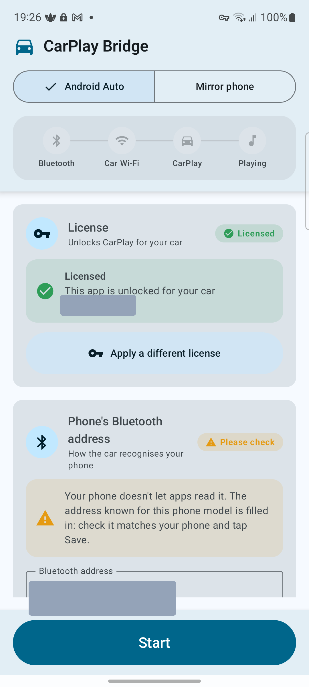
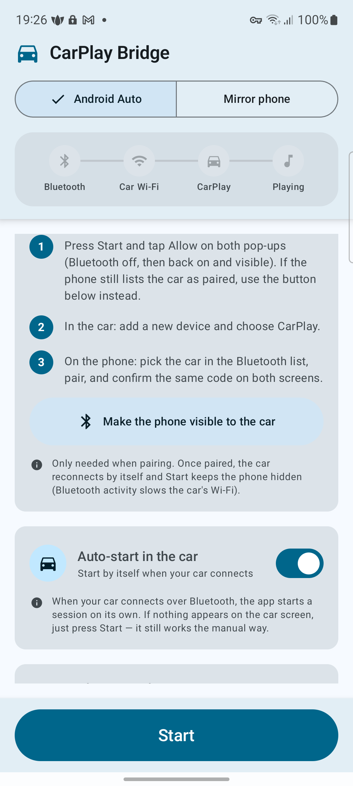
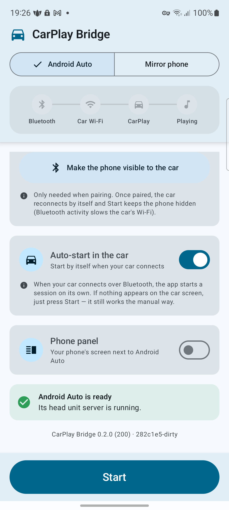
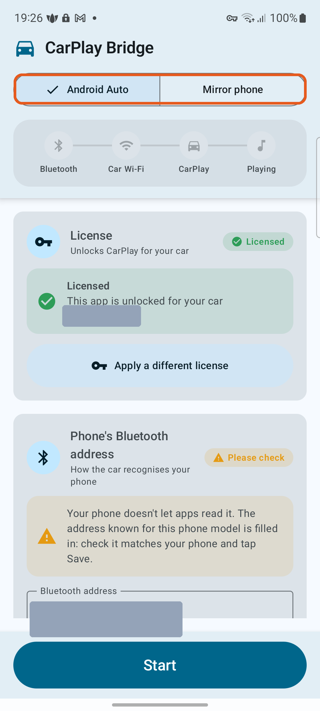
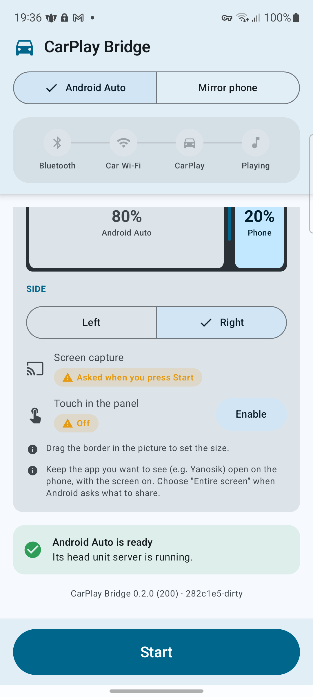

# CP Bridge

Turn an Android phone into a **wireless‑CarPlay "car"** so it can show **Android Auto** on your car's
built‑in screen — Maps, media, the Assistant, with car touch, audio, microphone and the voice button.
(It can also mirror the phone's screen instead.) In Android Auto mode you can even add a **side panel that
mirrors your phone** next to Android Auto — e.g. a second navigation app beside Maps. No root required.

*(The app installs on your phone as "CarPlay Bridge".)*

## ⬇️ Download  ·  💬 Get help

**[Download the latest `.apk`](https://github.com/hatak30/cp-bridge/releases/latest)** — then open it on the
phone and allow installing from unknown sources. (All versions are on the [Releases](../../releases) page.)

**Need a hand, or want to check if your car works?** Join the **[Discord](https://discord.gg/WJVFjbyq3j)** —
happy to help you get set up.

▶ **Watch the feature walkthrough:**

▶ **Auto‑start in the car & how phone calls work:**

> **Supported cars — read this first.** Confirmed working on the **BMW i8 with iDrive 6 (NBT Evo head unit)**
> over wireless CarPlay. It **may** work on newer iDrive versions or other BMWs, but that is **untested**, and
> other brands are unverified. There are no refunds for an unsupported car, so use the free (unlimited)
> mirroring to test it in *your* car before buying an Android Auto license.

## Screens

  
  
  

- **Home** — pick **Android Auto** or **Mirror phone**, follow the connection steps (Bluetooth → Car Wi‑Fi →
  CarPlay → Playing), and **Start / Stop**. The **License** card shows your Android Auto license status.
- **Pairing & Auto‑start** — the one‑time pairing steps and the optional **Auto‑start in the car** toggle.
- **Phone panel & status** — the **Phone panel** (your phone's screen beside Android Auto) and the
  "Android Auto is ready" check.

---

## Two modes

At the top of the app you choose what shows on the car's screen — the switch highlighted here:

- **Android Auto** — runs **Google Android Auto** on the car display: Maps, media, the Assistant, with car
  touch, audio, the microphone and the voice button — and, optionally, the **phone panel** (your phone's
  screen in a side strip beside it). This is the **paid** feature — it needs a license.

> [!IMPORTANT]
> **Phone calls stay on the phone.** The app bridges Android Auto's screen, media and voice (Maps, music,
> the Assistant) to the car — but **it does not route phone calls through the car's speakers or
> microphone.** During a call the audio and mic stay on the **phone itself**, exactly as if the app weren't
> running. If you want calls on the car speakers, **also pair your phone to the car as an ordinary
> Bluetooth hands‑free phone** (in the car's normal "add phone / Bluetooth" list, separately from this
> app) — then the car handles calls over its own Bluetooth, the same way it does with any phone.
- **Mirror phone** — shows **your phone's own screen** on the car, with car touch, so you can use any phone
  app on the car display. **Free, with no time limit** — no license needed.

Both run over the car's **wireless CarPlay** connection — the app makes your phone look like a CarPlay "car",
so the only thing you pick is what it shows once connected. Mirror is the default; switch at the top any time
(before you press Start).

---

## What you need

- An Android phone running **Android 12 or newer**.
- A car with **wireless Apple CarPlay**.
- The **Google Android Auto** app installed on the phone (from Play) — for Android Auto mode.
- A per‑car **license** to unlock **Android Auto** (see *Get a license* below). The license also carries the
  head‑unit certificate Android Auto needs, so it's installed for you on Activate.
- **Mirroring is free, with no time limit** — enough to confirm the app works in your car before you buy
  Android Auto.

---

## Install

1. Download the latest **`.apk`** from the [Releases](../../releases) page.
2. Open it on the phone and allow installing from unknown sources when prompted.
3. Install and open the app. Grant **Bluetooth** (and, on Android 13+, **notifications**) when asked.

The app is signed with the developer's own key, so Android will note it's from an "unknown source" — that's
normal for a sideloaded app. There are **no automatic updates**; check the Releases page for newer builds.

You may see a second launcher icon called **"Test Player"** — that's a diagnostic tool, ignore it.

---

## One‑time phone setup

### 1. Turn on Android Auto's "head unit server"

Android Auto only streams to a head unit after you enable its developer server:

1. Open **Android Auto settings** (the app's *Get Android Auto ready* card can open it for you).
2. Scroll to the bottom to **Version** and tap it **10 times** until it says *Developer mode enabled*.
3. Open the **⋮ menu** (top‑right) → **Start head unit server**.

You must repeat step 3 **after every phone restart** — the server does not survive a reboot or an Android
Auto update.

### 2. (Only some phones) Bluetooth address

The app normally detects your phone's Bluetooth address automatically. A few phones (some Honor/Samsung)
hide it — if the **Bluetooth address** card asks you to enter it, find it under
**Settings › About phone › Status › Bluetooth address**, type it in, and tap **Save**.

---

## Pair with your car (first time only)

**Start the pairing from the car, not from the phone's Bluetooth list.** If the phone initiates it, the car
treats it as an ordinary phone (music/calls only) and CarPlay never starts.

1. **On the phone:** press **Start**. Tap **Allow** on the two Bluetooth pop‑ups (the app briefly turns
   Bluetooth off and back on so CarPlay is offered correctly). The phone becomes visible for ~60 seconds.
2. **On the car:** add a new device / phone and choose **Apple CarPlay**. The car finds your phone.
3. **On the phone:** confirm the pairing and that the passkey matches on both screens.
4. When the car hands over its Wi‑Fi, a **"Connect to …?"** dialog appears on the phone — tap **Connect**
   within ~25 seconds.

After this, the car reconnects by itself next time — you just press **Start**.

---

## Mirroring is free — no time limit

**Mirror mode is completely free, for as long as you like** — no license needed. That covers the whole
wireless‑CarPlay connection to your car:

- Pairing with the car and the automatic **Wi‑Fi hand‑over**.
- Your **phone's screen on the car display**, with **car touch** and **sound** through the car speakers.
- The optional **Auto‑start in the car**.

It's also the real compatibility test: mirroring uses the **exact same connection as Android Auto**, so if
mirroring comes up cleanly on your car, the paid Android Auto will work too. **Try mirroring in your car
first** — there are no refunds for a car that turns out not to be supported.

**What free mirroring does *not* include: Android Auto.** Android Auto is the paid feature — it needs a
per‑car license (see below). Mirroring stays free either way.

## Get a license

Thank you for your interest in CarPlay Bridge! A license unlocks **Android Auto**. It is tied to
**this phone and your car's serial** — it won't work on another phone or another car.

**Two things are needed: your enrollment code (sent by email) _and_ the $30 donation.** The enrollment
code is what lets me build a license for your exact phone + car, so I can't issue one without it — the
donation alone isn't enough.

1. **Connect to your car once** (steps above) so the app learns your car's serial.
2. In the **License** card, tap **Request license by email**. Your email app opens, already addressed to
   **carplaybridge@proton.me** with your enrollment code (`CPBE1-…`) in the message — just send it.
   *(No email app? Tap **Copy enrollment code** and email the code to carplaybridge@proton.me yourself.)*
3. **Donate $30** at **<https://ko-fi.com/retroracer>**, and in the Ko‑fi message put the **same email
   address** you sent the code from, so I can match your payment to your enrollment code.
4. I'll email you your license — a longer code starting with `CPB2-…`.
5. In the app's **License** card, paste it in and tap **Activate**. If the card already says *Licensed*,
   tap **Apply a different license** first, then paste and Activate.

> [!IMPORTANT]
> **Phone calls stay on your phone.** Even with Android Auto unlocked, phone calls keep using the
> **phone's own microphone and speakers** — they are **not** routed through the car's speakers or mic.

The Android Auto head‑unit certificate is carried in the license and installs automatically on Activate —
it's stored only on your phone (its private key in the phone's secure hardware, never exported).

---

## Drive: start a session

1. Make sure **Wi‑Fi is on** (CarPlay carries the screen and sound over the car's Wi‑Fi).
2. At the top, pick the mode: **Mirror phone** (free) or **Android Auto** (needs a license).
   Mirror is the default.
3. Press **Start**. The header shows progress: **Bluetooth → Car Wi‑Fi → CarPlay → Playing**. Tap
   **Connect** on the Wi‑Fi dialog when it appears.
4. Your phone's screen — or Android Auto — comes up on the car screen.
5. To stop, **long‑press Stop** (a quick tap only shows "Hold to stop", so you can't end a drive by accident).

---

## Phone panel — your phone *inside* Android Auto

In **Android Auto** mode you can split the car screen and **mirror your phone in a side panel next to Android
Auto**. That gives you a second app on the car display at the same time — another navigation app, a dashcam
view, OBD gauges, anything running on your phone — and you can touch it right there on the car screen.

To set it up (in **Android Auto** mode):

1. Turn on the **Phone panel** switch.
2. **Drag the border** in the preview to set the split (e.g. 80% Android Auto / 20% phone), and pick which
   **Side** the panel sits on (Left / Right).
3. If you want to tap the phone app on the car screen, turn on **Touch in the panel** — it opens Android's
   accessibility settings; enable **"CarPlay Bridge car touch"**.
4. Keep the app you want to show **open on the phone with the screen on**. When you press **Start**, allow
   **screen capture** and choose **"Entire screen"** when Android asks what to share.

---

## Auto‑start in the car (optional)

If you'd rather not press **Start** every time, turn on **Auto‑start in the car** (Android 13+). The app
will then start a session by itself when your car connects over Bluetooth.

- **One‑time setup:** pair and connect to your car once, then switch **Auto‑start in the car** on and
  confirm your car in the system dialog that appears.
- It's a **best‑effort, no‑fuss attempt**: on many phones it just comes up. If nothing appears on the car
  screen, simply press **Start** — the manual way always works and is still there as a fallback.
- On some phones (often Honor and similar) the car doesn't always recognise CarPlay on the first try; there
  the manual **Start** remains the reliable path.
- **Battery settings (important on Honor/Huawei/Xiaomi):** when you turn Auto‑start on, the app asks to be
  exempt from battery optimisation — tap **Allow**. These phones also have an extra "protected apps" /
  "app launch" manager that can freeze the app in the background (symptom: you have to open the app for the
  car to finish connecting). Set the app to **Allow background activity / Launch manually / no restrictions**
  (Honor/Huawei: *Settings › Battery › App launch › CarPlay Bridge › Manage manually*, enable all three;
  Xiaomi: *Autostart* + *No restrictions*).

## Options

- **Phone panel** (Android Auto mode): mirror your phone in a side strip next to Android Auto — see
  *"Phone panel — your phone inside Android Auto"* above.
- **Mirror mode**: show the phone's screen on the car instead of Android Auto. Needs the accessibility
  **"CarPlay Bridge car touch"** service (enable it in Android Settings; the app's button opens the page).

---

## Troubleshooting

- **Car says "Waiting for Android Auto…"** — the head‑unit server isn't running. Android Auto → ⋮ →
  *Start head unit server*, then press Start.
- **Nothing happens after pairing** — Wi‑Fi may be off, or you missed the **Connect** dialog. Press Start
  again and tap **Connect** when it appears.
- **"Not licensed for this car"** — activate a license for this car. A license is tied to this phone + car.
- **CarPlay connects but Android Auto doesn't appear** — re‑activate your license (the head‑unit certificate
  comes with it). If you cleared app data or reinstalled, request a fresh license for the new enrollment code.
- **Screen stutters** — leave Bluetooth discoverability off during a drive (the app already does this once
  paired).
- **Phone calls come out of the phone, not the car** — that's expected. The app does **not** carry calls to
  the car's speakers/microphone; call audio and the mic stay on the phone. To get calls on the car, pair
  your phone to the car as a normal **Bluetooth hands‑free phone** as well (see the note under *Two modes*).
- **Connection drops out / picture freezes on a weak signal** — the app keeps the phone's screen on and its
  Wi‑Fi in high‑performance mode while connected, which helps. Keep the phone somewhere with a good signal to
  the car (on the dash, not buried in a pocket), and keep Wi‑Fi on.

### Sending us a log

If we're helping you with a problem, a log makes it much faster to find. Scroll to the **Logs** card at the
bottom of the app, turn **Save diagnostic logs** on, reproduce the issue once, then tap **Send logs by
email** — it's pre‑addressed to us. Logs stay on your phone until you send them, and never leave it on their
own.

**Still stuck?** Ask on the **[Discord](https://discord.gg/WJVFjbyq3j)** — include your car model and what
step it fails at.

---

## How this differs from BMW's built‑in MirrorLink

iDrive 6 / NBT Evo has its own Android mirroring — **MirrorLink** — but it only works with MirrorLink‑certified
apps, a tiny, now‑abandoned set that today's phones mostly dropped. CP Bridge instead rides the car's
**CarPlay** connection and handles input itself, so you get full **Android Auto** (or any app mirrored), with
**touch on the car's screen** (and the rotary iDrive controller) — not just a short list of certified apps.

---

## Privacy & security

- Your license and the head‑unit key live **only on your phone** (the key in secure hardware, never on
  disk, never exported).
- No account, no sign‑in, no tracking. The app talks to your car and — for Android Auto — to the Android
  Auto app over the phone's own internal network.
- **Root is not required.**
